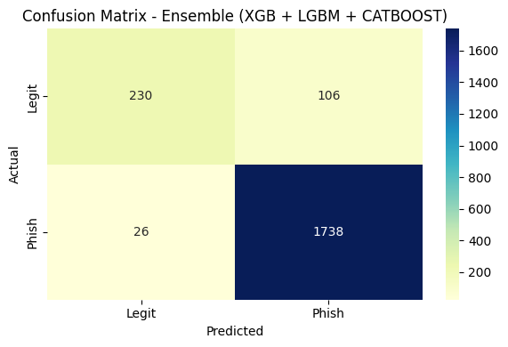
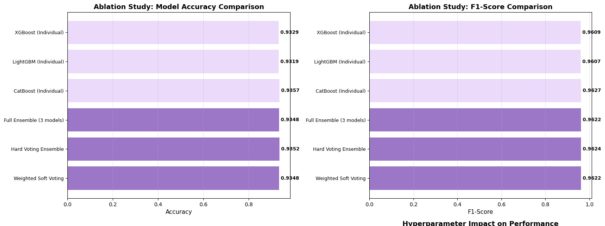
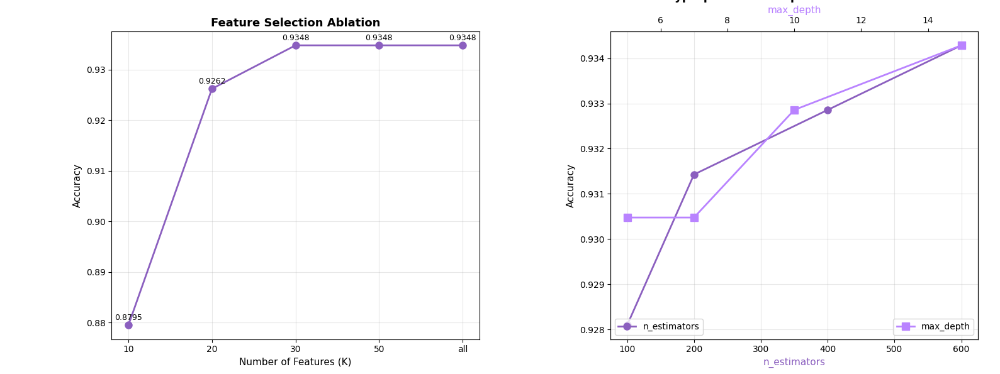

# Phishing Website Detection Using Machine Learning

**A machine learning-based phishing website detection framework combining gradient boosting models, ensemble learning, feature selection, and systematic ablation analysis.**

## Overview

This project develops a binary classification framework to distinguish phishing websites from legitimate websites using URL-based features.

The implementation investigates three gradient boosting algorithms: XGBoost, LightGBM, and CatBoost. A soft-voting ensemble combines their predictions, while stratified cross-validation and ablation experiments are used to evaluate model performance and examine the contributions of individual components.

## Key Features

- **Ensemble Learning:** Combines XGBoost, LightGBM, and CatBoost using soft voting.
- **Feature Selection:** Applies SelectKBest with the ANOVA F-test to identify informative URL features.
- **Class Imbalance Handling:** Implements SMOTE in an experimental preprocessing pipeline.
- **Cross-Validation:** Uses five-fold stratified cross-validation for model evaluation.
- **Ablation Analysis:** Examines individual models, pairwise ensembles, full ensembles, feature selection, and voting strategies.
- **Hyperparameter Analysis:** Investigates the impact of estimator count and maximum tree depth.
- **Performance Evaluation:** Uses accuracy, precision, recall, F1-score, ROC-AUC, and confusion matrices.

## Dataset

The project uses phishing website data containing URL-based and website-related features.

| Dataset | Samples |
|---|---:|
| Training | 8,955 |
| Testing | 2,100 |
| Input Features | 29 |

The target variable is `Statistical_report`, with labels converted into binary classes:

- 0: Phishing
- 1: Legitimate

The training dataset contains 7,741 legitimate and 1,214 phishing samples.

## Methodology

### 1. Data Preparation

- Load training and testing datasets.
- Clean column names and remove unnecessary identifier columns.
- Separate input features and target labels.
- Align the feature columns between datasets.

### 2. Feature Selection

Apply SelectKBest with the ANOVA F-test to select informative features. The ablation experiments compare different feature counts.

### 3. Machine Learning Models

Three gradient boosting algorithms are investigated:

- XGBoost
- LightGBM
- CatBoost

### 4. Ensemble Learning

A soft-voting ensemble combines the predicted class probabilities from the three base models.

Pairwise ensemble combinations and hard-voting strategies are also investigated.

### 5. Model Evaluation

The implementation includes five-fold stratified cross-validation and a separate evaluation on the provided test dataset.

### 6. Ablation Study

The experiments investigate:

- Individual model performance.
- Pairwise and full ensemble combinations.
- Feature selection impact.
- Hyperparameter impact.
- Hard versus soft voting strategies.

## Experimental Results

### Final Ensemble Performance

The recorded five-fold cross-validation experiment achieved:

| Metric | Result |
|---|---:|
| Mean CV Accuracy | 94.46% |
| CV Standard Deviation | 0.45% |

The final ensemble evaluation on the provided test dataset achieved:

| Metric | Result |
|---|---:|
| Test Accuracy | 93.71% |
| Macro Precision | 92% |
| Macro Recall | 83% |
| Macro F1-score | 87% |

### Ablation Study

The recorded ablation experiments produced the following results:

| Model | Accuracy |
|---|---:|
| XGBoost | 93.29% |
| LightGBM | 93.19% |
| CatBoost | 93.57% |
| XGBoost + LightGBM | 93.29% |
| XGBoost + CatBoost | 93.57% |
| LightGBM + CatBoost | 93.38% |
| Full Three-Model Ensemble | 93.48% |
| Hard Voting Ensemble | 93.52% |
| Weighted Soft Voting | 93.48% |

The ablation analysis indicates that CatBoost achieved the highest accuracy among the individual models, while the full ensemble provided a comparative evaluation of combining multiple boosting algorithms.

### Visualizations

#### Confusion Matrix



#### Model Comparison



#### Ablation Analysis



## Technologies Used

- Python
- NumPy
- Pandas
- Scikit-learn
- XGBoost
- LightGBM
- CatBoost
- Imbalanced-learn
- Matplotlib
- Seaborn

## Repository Structure

```text
phishing-website-detection/
│
├── README.md
├── requirements.txt
├── .gitignore
├── phishing_website_detection.ipynb
│
└── results/
    └── figures/
        ├── confusion_matrix.png
        ├── model_comparison.png
        └── ablation_analysis.png
```

## Installation and Execution

### 1. Clone the Repository

```bash
git clone https://github.com/sn-sakib/phishing-website-detection.git

cd phishing-website-detection
```

### 2. Install Dependencies

```bash
pip install -r requirements.txt
```

### 3. Dataset Preparation

Obtain the original training and testing CSV files and configure their paths in the notebook.

The notebook expects the training and testing datasets to be accessible from the configured Kaggle input directory.

### 4. Run the Notebook

```bash
jupyter notebook phishing_website_detection.ipynb
```

Execute the notebook cells sequentially.

## Author

**Syed Nazmus Sakib**

Machine Learning | Artificial Intelligence | Cybersecurity | Deep Learning

[GitHub Profile](https://github.com/sn-sakib)
